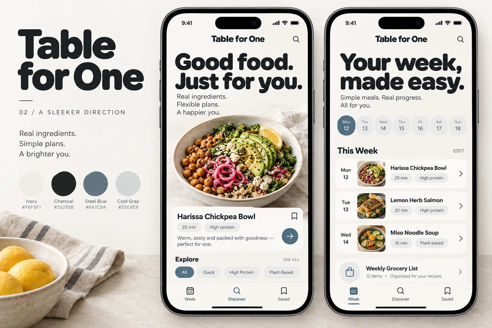

# Table for One — Design reference

Version 1.0 · October 26, 2026

## Approved direction

**Modern Kitchen / A sleeker direction.** Keep concept 02's bold, rounded typography and pair it with ivory, charcoal, steel blue, and cool gray. The result should feel confident, welcoming, calm, and polished. Food photography brings the color; the interface stays restrained.

This is the approved visual direction, not a finished production UI. The measurements and component rules below are proposed starting specifications. The concept image is AI generated; its font is a visual reference, not an identified or licensed font file. Recipe imagery and copy are illustrative.

## Color palette

| Color      | HEX       | RGB           | Primary role                                               |
| ---------- | --------- | ------------- | ---------------------------------------------------------- |
| Ivory      | `#F6F5F1` | 246, 245, 241 | Main screen background; soft, warm foundation              |
| Charcoal   | `#25292B` | 37, 41, 43    | Headlines, body copy, icons, primary high-contrast buttons |
| Steel Blue | `#647C8A` | 100, 124, 138 | Selected controls, active navigation, restrained accent    |
| Cool Gray  | `#E5E9E9` | 229, 233, 233 | Unselected pills, separators, secondary surfaces           |

Supporting surface: white `#FFFFFF` for cards and sheets when separation is needed. Use ivory and white across most of the screen, charcoal for structure, and steel blue sparingly. Avoid adding lavender, bright orange, cobalt, gradients, or decorative accent colors to the core theme.

### Readability

Use charcoal for small text on light surfaces. Steel blue is an accent, not the default body-text color. White on steel blue and steel blue on ivory fall below a 4.5:1 normal-text contrast target; use charcoal buttons with ivory labels for small primary-action text. Pair selected states with an icon, label, outline, or weight change. Error and success states will need separate semantic colors and validation before implementation.

## Typography

- **Brand and hero headings:** heavy, rounded sans serif with soft terminals and compact spacing; preserve the friendly, substantial letter shapes from concept 02.
- **Body and controls:** clean sans serif with open shapes and regular/medium weights. Use semibold for recipe titles and section headings.
- **Hierarchy:** oversized expressive headlines, compact section titles, comfortable body copy, and quiet metadata. Avoid serif headings and handwritten decorations.
- **Font selection:** choose and test a real rounded display family against the reference before implementation. Do not treat the generated lettering as a specified font. Confirm licensing and platform rendering after selection.

Proposed phone scale: hero 36–44 pt / 1.05–1.12 line height; brand 22–26 pt; section heading 20–24 pt; recipe title 17–20 pt; body 16–17 pt / 1.4–1.5; metadata 13–14 pt; navigation 12–13 pt. Keep body copy readable and support system text scaling. Adjust hero size and wrapping on smaller phones.

## Layout and components

- Use an 8 pt spacing rhythm: 8, 16, 24, 32. Start with 20–24 pt screen gutters, 16 pt card padding, and 24–32 pt between sections.
- Use generous whitespace, subtle fine dividers, minimal shadows, and consistent 16–20 pt card corners. Reserve fully rounded shapes for pills and day selectors.
- Recipe cards: large food photograph, clear title, two or three metadata chips, bookmark control, and one obvious action.
- Category filters: cool-gray background with charcoal text when idle. Selected filters use a steel-blue accent plus a clear selection cue; retain legible charcoal labels on a light fill for small text.
- Week planner: horizontal day selector, followed by tidy meal rows with a thumbnail, title, time, and dietary detail. Keep the grocery summary below the meals.
- Navigation reference: Week, Discover, Saved. Use consistent outline icons with a stronger selected state and text labels. Expand navigation only as actual product scope requires.
- Make interactive areas at least 44 × 44 pt. Include visible keyboard focus, accessible control names, and selected-state announcements.

## Photography and voice

Choose natural light, appetizing close-ups, neutral ceramic plates, and subtle linen or stone. Keep dishes believable for one person and let the ingredients supply vivid color. Avoid busy backgrounds, heavy filters, and text over detailed food imagery.

Voice: friendly, direct, encouraging. Useful reference copy: “Good food. Just for you.” and “Your week, made easy.” Keep supporting copy short and practical. Avoid guilt, diet pressure, and excessive motivational slogans.

## Screen references

**Discover:** compact brand header and search; bold headline; featured recipe photo and details; simple category filters; persistent bottom navigation.

**This Week:** bold planning headline; date/day strip; planned meals in clear rows; weekly grocery summary; persistent bottom navigation.

## Handoff checklist

Preserve the rounded display typography, quiet neutral surfaces, restrained steel-blue accents, and generous spacing. Before shipping, select the font files, secure production photo rights, test contrast and text scaling, design loading/empty/error states, and validate layouts on iPhone and iPad. This guide records the design decision; it does not indicate the app has been restyled.
